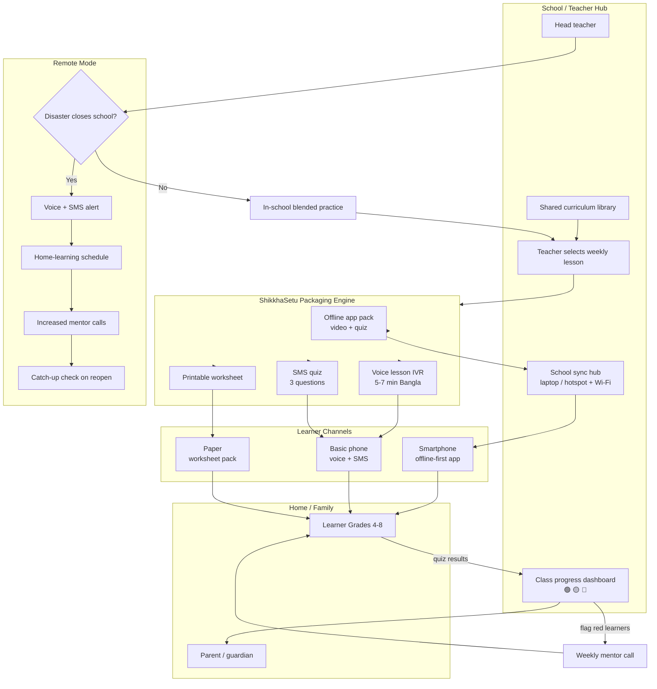
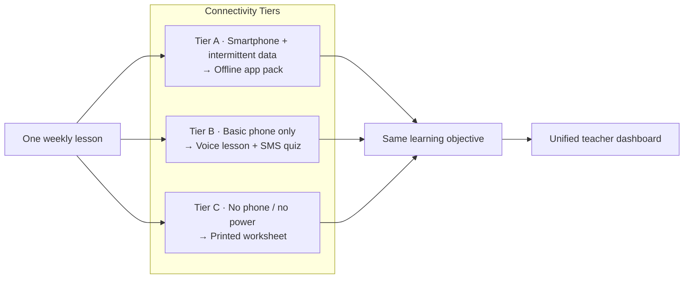

# ShikkhaSetu

### A Connectivity-Tiered Blended Learning System That Keeps Bangladeshi Children Learning When Schools Close

> **YSSE | Tech Research & Innovation Wing | Reimagine the Future**  
> Prepared by Shadiya Zaman Tanha · Intern · Tech Research and Innovation Wing  
> Documentation deadline: ~~draft outline~~ · **8 November 2026 (today)**

---

## Table of Contents

1. [Brief Summary](#1-brief-summary)
2. [Problem Statement & Target Users](#2-problem-statement--target-users)
3. [Existing Solutions](#3-existing-solutions)
4. [Identified Gap & Opportunity](#4-identified-gap--opportunity)
5. [Proposed Solution & Key Features](#5-proposed-solution--key-features)
6. [System Architecture (Mermaid)](#6-system-architecture-mermaid)
7. [Feature & Feasibility Analysis](#7-feature--feasibility-analysis)
8. [Pilot Plan & Task Tracker](#8-pilot-plan--task-tracker)
9. [Risks & Mitigations](#9-risks--mitigations)
10. [References](#10-references)

---

## 1. Brief Summary

Bangladesh has expanded school access, but learning remains weak and schooling is repeatedly interrupted. Schools were closed for **543 days** during COVID-19, and in 2024 heatwaves, Cyclone Remal and floods disrupted schooling for **35 million children**. When schools close, most remote options assume a television, internet or smartphone - and only a small share of students actually use them.

**ShikkhaSetu** (Bangla for *"learning bridge"*) is a blended learning concept in which a school's own teacher sends each weekly lesson through **three channels at once**:

| Channel | Format |
| --- | --- |
| Offline-first smartphone app | Short video + quiz (downloaded once over school Wi-Fi) |
| Basic-phone voice + SMS | 5-7 min Bangla voice lesson + 3-question SMS quiz |
| Printed worksheet | Paper pack for no-phone / no-power households |

On normal days it supports classroom learning with home practice. When a disaster closes schools, a single **Remote Mode** switch keeps every learner connected to the same teacher.

> **Status:** Concept is untested. This document presents the evidence, the gap, the concept design, and a feasibility plan for a small pilot.

---

## 2. Problem Statement & Target Users

### The problem

Many Bangladeshi children are not achieving basic learning, their schooling is frequently interrupted, and the remote learning that exists does **not** reach most of the children who need it.

### Verified evidence

| Finding | Evidence |
| --- | --- |
| Weak foundational learning | **51%** of children could not read and understand a simple text by age 10 (World Bank learning poverty, 2022) |
| Repeated disruption | **543** consecutive school-closure days (Mar 2020-Sep 2021); 2024 climate events disrupted **35M** children; Sylhet lost up to **8 weeks** |
| Low remote reach | BIDS survey (50,871 students, 63 districts): only **9-11%** primary and **16.2%** secondary engaged with televised lessons |
| Device / connectivity gap | **99%** households have a mobile phone; **74.9%** smartphone; only **59.2%** internet (**56.4%** rural); **3.7%** rural households have a computer |

### Target users

- **Students** in Grades 4-8 in rural and climate-vulnerable upazilas (especially poorer households)
- **Teachers** who lose contact with learners during closures
- **Parents** (often mothers) asked to support learning without guidance
- **Head teachers & upazila education officers** who need to know which children are falling behind

### Why it matters

SDG 4 requires inclusive and equitable quality education. Each closure deepens an existing learning crisis - and the children least able to learn remotely are those from the poorest and most rural households.

---

## 3. Existing Solutions

| Solution | What it does well | What falls short for this problem |
| --- | --- | --- |
| Government TV & online classes (Sangsad TV, Konnect) | Free, national scale, launched quickly | One-way; needs a TV; only 9-16% engagement; no link to the child's own teacher |
| 10 Minute School (private EdTech) | Dominant K-12 player; curriculum coverage | Needs smartphone + data; premium is paid; not linked to school/teacher |
| Muktopaath & Teachers' Portal (a2i) | Proven teacher reach (96.47% course completion) | Built for teacher training, not daily teacher-to-learner contact |
| Kolibri (Learning Equality) | Offline-first; works without internet; teacher dashboards | Needs tablets/computers; does not reach basic-phone homes |
| Phone call + SMS tutoring (Botswana trial) | +0.12 SD learning; highly cost-effective | SMS alone had no effect; numeracy only; not integrated with schools |

### Research takeaways

1. Channels that need TV or internet reached a **minority** of students.
2. Live human contact by phone produced gains where one-way messages did not.
3. Bangladesh already has building blocks: curriculum content, national teacher platforms, near-universal mobile phones, and a **National Blended Education Master Plan (2022-2041)** that combines high-, low- and no-tech learning.

> **Caution:** A Bangladesh phone-mentoring trial reported large gains, but a 2025 Institute for Replication comment raised serious data-integrity concerns - this concept does **not** rely on that study.

---

## 4. Identified Gap & Opportunity

### The gap

None of the solutions reviewed combines all three of:

1. The child's **own school teacher**
2. The **same lesson** delivered across smartphone, basic phone **and** paper
3. A ready switch between **in-school blended mode** and **full remote mode** when disasters strike

### Opportunity

- **In Bangladesh:** a low-cost layer that plugs into existing government platforms and the Blended Education Master Plan, aimed at upazilas that lose the most school days to floods and heat.
- **Worldwide:** at least **463 million** schoolchildren could not be reached by remote learning during COVID-19; in 2024, **242 million** students in 85 countries had schooling disrupted by climate events (74% in low- and lower-middle-income countries).

### Assumptions still to test

- [ ] Teachers can spare ~1 extra hour per week
- [ ] Families will answer calls and share a guardian number
- [ ] SMS and voice costs stay affordable at scale

---

## 5. Proposed Solution & Key Features

### How it works

Each week the teacher selects a curriculum-aligned lesson from a shared library. ShikkhaSetu packages it for every channel. Learners study at home on whatever device the family has, answer a short quiz, and results flow back to a **single class dashboard**. In-school days are used for practice, discussion, and support for learners the dashboard flags.

### Key features

| Feature | Description |
| --- | --- |
| **One Lesson, Three Channels** | Offline app pack + Bangla voice lesson + SMS quiz + printable worksheet |
| **Learning Level Check** | Bi-weekly phone/app check groups learners into three levels for targeted support |
| **Weekly Mentor Call** | 15-min call to learners flagged red (no activity / low scores) by teacher or trained volunteer |
| **Remote Mode switch** | One tap by head teacher → voice/SMS alert to parents, home-learning schedule, higher call frequency; catch-up check on reopening |
| **Parent Nudges & Progress Dashboard** | Weekly voice message for low-literacy parents; green / yellow / red status per learner; rolls up to upazila level |

### Value proposition

- Students keep learning on **any phone** or on **paper**
- Teachers stay in contact
- Parents get simple guidance
- Education officers see who is falling behind **before** it becomes dropout

---

## 6. System Architecture (Mermaid)

### End-to-end learning flow

### Connectivity-tiered delivery model

---

## 7. Feature & Feasibility Analysis

Pilot scope: **6 months · 10 schools · one flood-prone upazila**.

| Feature | Priority | Feasibility | Effort | Dependencies | Notes |
| --- | --- | --- | --- | --- | --- |
| One Lesson, Three Channels (app + voice/SMS + paper) | Must-have | High | High | Curriculum specialist; Android + backend; SMS/IVR gateway; school printer | Core differentiator; packaging must be automatic to protect teacher time |
| Offline-first Android app + school sync hub | Must-have | High | Medium-High | Kolibri (or equivalent) evaluated as sync layer; school Wi-Fi / hotspot | Download-once model fits 56.4% rural internet rate |
| Voice lesson (IVR) + 3-question SMS quiz | Must-have | High | Medium | Mobile operator / aggregator; short-code / zero-rating approval | Evidence-backed channel for basic-phone homes |
| Printed worksheet packs | Must-have | Very High | Low | School printer; pre-monsoon distribution | Fallback when power or phones fail |
| Learning Level Check (bi-weekly) | Should-have | Medium-High | Medium | Assessment items aligned to Grades 4-8 | Enables targeted support vs. teaching only to grade |
| Weekly Mentor Call for red-flagged learners | Should-have | Medium | Medium | Volunteer mentors; preferred call-time data; safeguarding | Cap ~1 extra teacher hour/week; evening call windows |
| Remote Mode switch + parent alerts | Must-have | Medium | Medium | Head-teacher UX; IVR/SMS blast; upazila coordination | Differentiator for climate-disrupted upazilas |
| Parent voice nudges | Should-have | High | Low-Medium | IVR templates in Bangla | Suits low-literacy caregivers |
| Class → upazila progress dashboard | Should-have | Medium | Medium-High | Role-based access; encryption; DPE/DSHE data rules | Green / yellow / red roll-up for officers |
| Toll-free / zero-rated short code | Nice-to-have (pilot) / Must-have (scale) | Low-Medium | High | Operator agreement; regulatory approval | Pilot can start with paid SMS/voice + cost tracking |
| Full subject coverage beyond literacy/numeracy | Out of scope (v1) | Low | - | - | ~~Practical / lab subjects in v1~~ - deferred; voice/SMS suit literacy & numeracy first |

### Resource snapshot for the pilot

| Area | Initial assessment |
| --- | --- |
| **Skills** | Product designer, Android developer, backend developer, curriculum specialist (experienced teacher), field coordinator, part-time M&E researcher, volunteer mentors |
| **Tools** | Offline-first Android app; Kolibri (evaluated); SMS/voice gateway; school laptop or hotspot; school printer |
| **Timeline** | M1 co-design → M2-3 MVP + training → M4-5 pilot (+ simulated Remote Mode week) → M6 evaluate learning, usage, cost/learner |
| **Dependencies** | DPE/DSHE + upazila permission; content licensing; operator agreement; NGO or a2i partner; seed funding |
| **Benefits** | Reaches basic-phone households; keeps teacher-learner link; disaster preparedness; data to target support |

---

## 8. Pilot Plan & Task Tracker

### Month-by-month checklist

- [x] Concept note drafted (evidence, gap, design)
- [x] Doc-as-Code README / Notion page published
- [ ] Interview **10 teachers** and **20 parents** in one upazila (test assumptions)
- [ ] Build a **clickable prototype**
- [ ] Test a voice lesson + SMS quiz with **30 students**
- [ ] Approach **a2i** or an education NGO as pilot partner
- [ ] Secure DPE/DSHE and upazila education office permission
- [ ] Co-design with 5 teachers and 20 families (Month 1)
- [ ] Build MVP and train teachers (Months 2-3)
- [ ] Run pilot including one **simulated Remote Mode** week (Months 4-5)
- [ ] Evaluate learning, usage and **cost per learner** (Month 6)

### Limitations (accepted for v1)

- ShikkhaSetu **supports**, but cannot replace, classroom teaching
- Voice and SMS suit literacy and numeracy better than practical subjects
- Impact in Bangladesh is **unproven** until piloted

---

## 9. Risks & Mitigations

| Risk | Mitigation |
| --- | --- |
| Low call pickup / shared phone held by working parent | Record preferred call time; schedule evening calls; keep voice lessons on demand |
| Teacher workload | Automatic lesson packaging; volunteer mentors for calls; cap ≈1 extra hour/week |
| Privacy & child safeguarding | Collect only name, class, guardian number; written parental consent; role-based access + encryption; call guardian phone only; vet mentors; follow BD data-protection rules |
| Cost & power at scale | Negotiate zero-rating; fall back to worksheets; pre-distribute printed packs before monsoon |

---

## 10. References

1. Ali, S. M. Z., Shahana, S., & Islam, R. (2024). *Learning at a Distance*. BIDS Research Report 203. https://doi.org/10.57138/zevi5743  
2. Afzal, N., et al. (2025). *Scaling Online Teacher Professional Development in Bangladesh*. EdTech Hub. https://doi.org/10.53832/edtechhub.1102  
3. The Daily Star. (2025). *The Bangladesh edtech market*.  
4. The Daily Star. (2025). *Internet access grows in Q4…* (BBS ICT Access and Use Survey 2024-25).  
5. The Financial Express. (2025). *Internet, smart phone users up in country* (BBS ICT Access and Use Survey 2024-25).  
6. Angrist, N., Bergman, P., & Matsheng, M. (2022). Experimental evidence on learning using low-tech when school is out. *Nature Human Behaviour*. https://doi.org/10.1038/s41562-022-01381-z  
7. Learning Equality. *About Kolibri*. https://learningequality.org/kolibri/about-kolibri/  
8. UNICEF Bangladesh. (2021). MoPME, UNICEF, World Bank & GPE learning-loss press release.  
9. UNICEF Bangladesh. (2025). 35 million children disrupted by climate crises in 2024.  
10. UNESCO. (2025). Public digital learning platforms: Teachers' Portal.  
11. HundrED & EdTech Hub. (2023). *Spotlight on EdTech: Bangladesh* (National Blended Education Master Plan). https://doi.org/10.58261/misf7076  
12. The Open University. *3MPower* (Open Research Online).  
13. World Bank. (2020). *TV-Based Learning in Bangladesh: Is it Reaching Students?* https://doi.org/10.1596/34138  
14. World Bank. (2024). *Bangladesh Learning Poverty Brief 2024*.  
15. Hassan, H., et al. (2024). Telementoring and homeschooling… *The Economic Journal*. *(not relied upon - see [17])*  
16. 10 Minute School. Company profile (self-reported).  
17. Aparicio, J. P., et al. (2025). Comment on Hassan et al. Institute for Replication.  
18. UNICEF. (2020). At least a third of the world's schoolchildren unable to access remote learning.  
19. UNICEF. (2025). *Learning Interrupted: Global Snapshot of Climate-Related School Disruptions in 2024*.  
20-22. Wikimedia Commons photo credits (CC BY / CC BY-SA) used in the original concept visual panel.

---

*ShikkhaSetu · YSSE Tech Research & Innovation Wing · Reimagine the Future*  
*Source concept note: `Shadiya_Zaman_Tanha_InnovationChallenge.pdf`*
